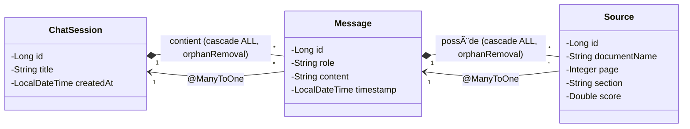
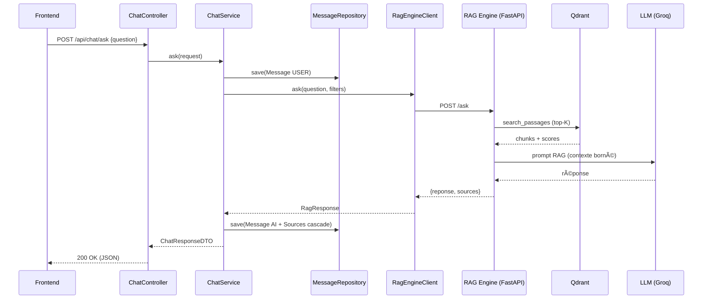
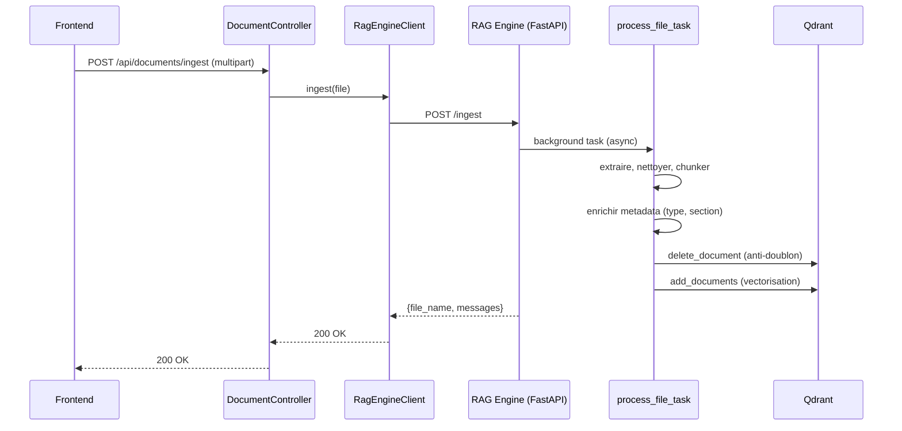
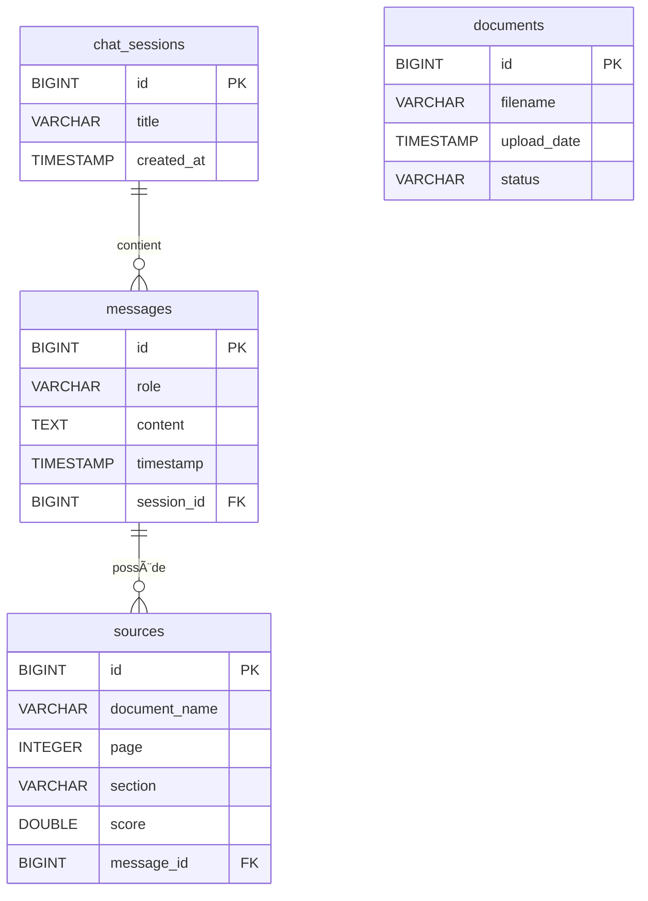

# MASRVI — Rapport technique du projet

> **Version :** 1.1 — 10/08/2026 *(refonte du client RAG : RestTemplate → RestClient, DTO typés, timeouts, erreurs centralisées)*
> **Périmètre :** `masrvi-project` (core-backend, rag-engine, frontend)
> **Diagrammes :** `MASRVI_CLASS_DIAGRAM.mmd` (Mermaid) / `MASRVI_CLASS_DIAGRAM.puml` (PlantUML) à la racine

---

## Table des matières

1. [Introduction et objectifs](#1-introduction-et-objectifs)
2. [Vue d'ensemble architecturale](#2-vue-densemble-architecturale)
3. [Backend Spring Boot — masrvi-core-backend](#3-backend-spring-boot--masrvi-core-backend)
4. [Moteur RAG — masrvi-rag-engine](#4-moteur-rag--masrvi-rag-engine)
5. [Frontend Angular — masrvi-frontend](#5-frontend-angular--masrvi-frontend)
6. [Flux fonctionnels (diagrammes de séquence)](#6-flux-fonctionnels-diagrammes-de-séquence)
7. [Modèle de données relationnel](#7-modèle-de-données-relationnel)
8. [Décisions techniques](#8-décisions-techniques)
9. [Sécurité et perspectives](#9-sécurité-et-perspectives)

---

## 1. Introduction et objectifs

MASRVI est un **assistant RAG (Retrieval-Augmented Generation)** d'entreprise : l'utilisateur pose une question en langage naturel, le système récupère les passages pertinents dans une base de documents vectorielle (Qdrant), puis un LLM génère une réponse fondée **exclusivement** sur ces extraits, en citant les sources (nom du document + page + section).

L'objectif fonctionnel est de fournir aux collaborateurs un accès conversationnel à la documentation interne, avec une garantie de **fiabilité** (aucune invention, réponse bornée au contexte) et une **traçabilité** (sources citées).

Le monorepo est composé de trois modules :

| Module | Technologie | Rôle |
|---|---|---|
| `masrvi-core-backend` | Spring Boot 3.3 · Java 17 · PostgreSQL | API REST, persistance, orchestration, proxy vers le moteur RAG |
| `masrvi-rag-engine` | FastAPI · Python · LangChain · Qdrant | Ingestion de documents, vectorisation, recherche sémantique, génération de réponses |
| `masrvi-frontend` | Angular | Interface utilisateur (squelette en cours) |

---

## 2. Vue d'ensemble architecturale


**Flux général d'une question :** Frontend → Backend (`POST /api/chat/ask`) → persistance du message utilisateur → appel du moteur RAG (`/ask`) → recherche vectorielle filtrée dans Qdrant → construction du prompt RAG → génération par le LLM → persistance de la réponse + sources → retour du DTO au frontend.

---

## 3. Backend Spring Boot — masrvi-core-backend

### 3.1 Structure des packages

```
com.masrvi.core
├── MasrviCoreApplication.java        Point d'entrée Spring Boot
├── client/RagEngineClient.java       Client HTTP (RestClient) vers le moteur RAG (FastAPI)
├── config/                           Configurations Spring
│   ├── CorsConfig.java               CORS (frontend Angular)
│   └── RestClientConfig.java         Bean RestClient + timeouts vers le moteur RAG
├── controller/                       Couche API REST
│   ├── ChatController.java
│   ├── ChatSessionController.java
│   └── DocumentController.java
├── dto/                              Objets de transfert
│   ├── AskRequestDTO.java            (record)
│   ├── ChatMessageDTO.java           (record)
│   ├── ChatResponseDTO.java          (record)
│   ├── IngestResponseDTO.java        (record, réponse typée /ingest)
│   ├── ReloadResponseDTO.java        (record, réponse typée /reload)
│   ├── SourceDTO.java                (record)
│   └── ChatSessionSummaryDTO.java    (classe @Data + @Builder)
├── entity/                           Entités JPA
│   ├── ChatSession.java
│   ├── Message.java
│   ├── Source.java
│   └── DocumentMetadata.java
├── exception/                        Gestion des erreurs
│   ├── GlobalExceptionHandler.java
│   └── RagEngineException.java
├── repository/                       Accès aux données (Spring Data JPA)
│   ├── ChatSessionRepository.java
│   ├── MessageRepository.java
│   └── DocumentMetadataRepository.java
└── service/ChatService.java          Logique métier
```

### 3.2 Modèle de données (entités JPA)

#### `ChatSession` — table `chat_sessions`
Une session de conversation.

| Attribut | Type | Contrainte | Description |
|---|---|---|---|
| `id` | `Long` | `@Id`, auto-généré | Identifiant |
| `title` | `String` | — | Titre affiché |
| `createdAt` | `LocalDateTime` | `@Column(nullable = false)` | Date de création, posée par `@PrePersist` |
| `messages` | `List<Message>` | `@OneToMany(mappedBy="chatSession", cascade=ALL, orphanRemoval=true)` | Messages de la session |

#### `Message` — table `messages`
Un message échangé (utilisateur ou IA).

| Attribut | Type | Contrainte | Description |
|---|---|---|---|
| `id` | `Long` | `@Id`, auto-généré | Identifiant |
| `role` | `String` | `nullable=false` | `"USER"` ou `"AI"` |
| `content` | `String` | `columnDefinition="TEXT"` | Contenu du message |
| `timestamp` | `LocalDateTime` | `nullable=false` | Horodatage, posé par `@PrePersist` |
| `chatSession` | `ChatSession` | `@ManyToOne(fetch=LAZY)`, `@JoinColumn("session_id")` | Session parente |
| `sources` | `List<Source>` | `@OneToMany(mappedBy="message", cascade=ALL, orphanRemoval=true)` | Sources ayant servi à la réponse |

#### `Source` — table `sources`
Une source citée dans une réponse IA.

| Attribut | Type | Contrainte | Description |
|---|---|---|---|
| `id` | `Long` | `@Id`, auto-généré | Identifiant |
| `documentName` | `String` | `nullable=false` | Nom du document |
| `page` | `Integer` | — | Numéro de page (nullable, ex. fichier `.txt`) |
| `section` | `String` | — | Section du document (ex. « Chapitre 2 ») |
| `score` | `Double` | — | Score de pertinence renvoyé par le moteur RAG |
| `message` | `Message` | `@ManyToOne(fetch=LAZY)`, `@JoinColumn("message_id")` | Message IA associé |

#### `DocumentMetadata` — table `documents`
Métadonnées des documents indexés (non encore branché au flux d'ingestion).

| Attribut | Type | Contrainte | Description |
|---|---|---|---|
| `id` | `Long` | `@Id`, auto-généré | Identifiant |
| `filename` | `String` | `nullable=false` | Nom du fichier |
| `uploadDate` | `LocalDateTime` | `nullable=false` | Date d'upload, posée par `@PrePersist` |
| `status` | `String` | `nullable=false` | `"PROCESSING"`, `"INDEXED"`, `"ERROR"` |

### 3.3 Relations JPA et cascade

Les relations bidirectionnelles sont des **compositions** en UML (losange plein) : le cycle de vie de l'enfant dépend entièrement du parent, grâce à `cascade = CascadeType.ALL` + `orphanRemoval = true`.



**Conséquences pratiques :**
- Enregistrer un `ChatSession` (ou `Message`) persiste récursivement ses enfants.
- Supprimer un parent supprime ses enfants (`orphanRemoval`).
- Les relations navigables `@ManyToOne` sont en chargement **LAZY** pour éviter de charger l'objet graph complet inutilement.
- `@ToString` et `@EqualsAndHashCode` excluent les relations pour éviter les boucles infinies de sérialisation / de comparaison.

### 3.4 Couche DTO

Les DTO isolent l'API de la représentation persistée. Quatre sont des **records** Java (immuables, génération automatique de `constructor`, accesseurs `field()`, `equals/hashCode/toString`) ; un seul est une classe Lombok `@Data` + `@Builder`.

| DTO | Type | Champs | Rôle |
|---|---|---|---|
| `AskRequestDTO` | `record` | `sessionId`, `question`, `sourceFilter`, `typeFilter` | Requête d'une question |
| `ChatMessageDTO` | `record` | `id`, `role`, `content`, `timestamp`, `sources: List<SourceDTO>` | Message exposé à l'API |
| `ChatResponseDTO` | `record` | `sessionId`, `userMessage`, `aiMessage` | Réponse complète d'un `ask` |
| `SourceDTO` | `record` | `documentName` (alias JSON `document_name`), `page`, `score`, `section` | Source exposée à l'API |
| `ChatSessionSummaryDTO` | classe `@Data @Builder` | `id`, `title`, `createdAt`, `messageCount` | Résumé d'une session pour la liste |

**Pourquoi records :** immutabilité (pas de mutation accidentelle), zéro boilerplate, sérialisation Jackson native (Spring Boot 3). Le `@JsonAlias("document_name")` de `SourceDTO` gère le format snake_case renvoyé par le moteur Python.
**Pourquoi `ChatSessionSummaryDTO` est une classe :** historique d'écriture ; il est construit via un builder fluent dans `ChatService` (lisibilité du mapping). Une conversion en record est possible sans changement fonctionnel.

### 3.5 Couche Repository

Interface Spring Data JPA, héritant de `JpaRepository<T, Long>` :

| Repository | Méthodes |
|---|---|
| `ChatSessionRepository` | héritées (`findAll`, `findById`, `save`…) |
| `MessageRepository` | héritées + `findByChatSessionIdOrderByTimestampAsc(Long)` |
| `DocumentMetadataRepository` | héritées |

### 3.6 Couche service — `ChatService`

Classe centrale, annotée `@Service`, construite par injection de constructeur (`@RequiredArgsConstructor`).

| Méthode | Description |
|---|---|
| `ask(AskRequestDTO) : ChatResponseDTO` | Orchestration complète d'une question (voir 3.7) |
| `getAllSessions() : List<ChatSessionSummaryDTO>` | Liste des sessions résumées (lecture seule) |
| `getSessionMessages(Long) : List<ChatMessageDTO>` | Historique d'une session, ordonné par timestamp ; lève `EntityNotFoundException` si absente |
| `toDTO(Message) : ChatMessageDTO` | Mapping privé entité → DTO (flat, sans relation cyclique) |

### 3.7 Flux `ask` — séquence détaillée

```
1.  Récupérer la session (request.sessionId) ou en créer une nouvelle
    → title = "Session du {date du jour}"
2.  Persister le message USER (role="USER", content=question)
3.  Hors transaction : appeler le moteur RAG via RagEngineClient.ask()
    (pas de @Transactional pour ne pas bloquer la base pendant l'appel HTTP)
4.  Persister la réponse IA (role="AI", content=réponse du moteur)
5.  Si le moteur a renvoyé des sources → les mapper en entités Source
    et les rattacher au message IA (sauvegardées en cascade par JPA)
6.  Construire et retourner ChatResponseDTO(sessionId, userMessage, aiMessage)
```

**Point de vigilance :** `getAllSessions()` accède à `s.getMessages().size()` ; le `@Transactional(readOnly=true)` garantit la disponibilité de la relation lazy dans ce contexte.

### 3.8 API REST

| Méthode | Endpoint | Contrôleur | Description |
|---|---|---|---|
| `POST` | `/api/chat/ask` | `ChatController` | Poser une question (JSON `AskRequestDTO`) |
| `GET` | `/api/chat/sessions` | `ChatSessionController` | Liste résumée des sessions |
| `GET` | `/api/chat/sessions/{id}/messages` | `ChatSessionController` | Historique complet d'une session |
| `POST` | `/api/documents/ingest` | `DocumentController` | Uploader un document (multipart) vers le moteur RAG |
| `POST` | `/api/documents/reload` | `DocumentController` | Recharger l'index depuis le corpus |

### 3.9 Client RAG — `RagEngineClient`

Proxy HTTP vers le moteur RAG, basé sur **`RestClient`** (Spring 6.1, successeur de `RestTemplate`). La connexion est configurée dans `config/RestClientConfig.java` (bean `RestClient` avec `baseUrl` = `rag.engine.url` → `http://localhost:8000` et **timeouts** : 5 s connexion / 60 s réponse).

| Méthode | Endpoint cible | Corps |
|---|---|---|
| `ask(question, sourceFilter, typeFilter) : RagResponse` | `POST /ask` | JSON `{question, source_filter?, type_filter?}` |
| `reload() : ReloadResponseDTO` | `POST /reload` | — |
| `ingest(MultipartFile) : IngestResponseDTO` | `POST /ingest` | `multipart/form-data` (fichier) |

La classe imbriquée `RagResponse` (`@Data`) porte `reponse` et `sources: List<SourceDTO>`. `reload()` et `ingest()` retournent des **DTO typés** (`ReloadResponseDTO`, `IngestResponseDTO`) dont les `@JsonProperty` conservent le format snake_case du moteur Python (`file_name`, `nb_passages`) — contrat API identique à l'ancien relais de `Map`.

**Gestion d'erreurs centralisée** dans `RagEngineClient.execute()` :
- erreurs **HTTP 4xx/5xx** → `onStatus` + `handleError` → `RagEngineException` avec le corps de la réponse ;
- erreurs **réseau/techniques** (`RestClientException`) → enveloppées en `RagEngineException`.

Les services appelants n'ont plus à gérer les erreurs eux-mêmes (`ChatService` a été simplifié) : tout aboutit à `GlobalExceptionHandler` → HTTP 503.

### 3.10 Gestion des exceptions

`GlobalExceptionHandler` (`@ControllerAdvice`) centralise les réponses d'erreur :

| Exception | HTTP | Message |
|---|---|---|
| `RagEngineException` (IA indisponible) | `503 Service Unavailable` | « Erreur de communication avec le moteur RAG » |
| `EntityNotFoundException` (JPA) | `404 Not Found` | Message du service (ex. session inexistante) |

Le corps est normalisé : `{timestamp, status, error, message}`.

### 3.11 Configuration — `application.properties`

| Propriété | Valeur | Rôle |
|---|---|---|
| `server.port` | `8080` | Port du backend |
| `spring.datasource.url` | `jdbc:postgresql://localhost:5432/masrvidb` | Base PostgreSQL |
| `spring.jpa.hibernate.ddl-auto` | `update` | Création/maj des tables sans perte (dev) |
| `rag.engine.url` | `http://localhost:8000` | URL du moteur RAG |
| `masrvi.frontend.url` | `http://localhost:4200` | Origine CORS autorisée (Angular) |

---

## 4. Moteur RAG — masrvi-rag-engine

### 4.1 Rôle

Convertir des documents en **chunks vectorisés** stockés dans Qdrant, puis, pour chaque question : rechercher les chunks les plus pertinents, construire un prompt strict, et demander au LLM une réponse **bornée au contexte** avec citations.

```
masrvi-rag-engine
├── app/main.py                 Application FastAPI (endpoints)
├── app/models.py               Modèles Pydantic
├── core/exchange.py            Génération de réponse RAG
├── core/process_document.py    Pipeline d'ingestion
├── retrieval/qdrant_client.py  Accès Qdrant (index, recherche, filtres)
├── retrieval/semantic_chunker.py  Découpage sémantique
├── utils/clients.py            Embeddings (Ollama/HF) + LLM (Groq)
└── config.py                   Constantes d'environnement
```

### 4.2 API FastAPI

| Méthode | Endpoint | Modèle réponse | Description |
|---|---|---|---|
| `GET` | `/health` | — | Sonde de santé |
| `POST` | `/ask` | `AnswerResponse` | Répond à une question (avec filtres optionnels) |
| `POST` | `/ingest` | `IngestResponse` | Ingère un fichier en arrière-plan |
| `POST` | `/reload` | `ReloadResponse` | Vide l'index et re-ingère depuis `corpus/` |

### 4.3 Modèles Pydantic (`app/models.py`)

| Modèle | Champs |
|---|---|
| `SourceItem` | `document_name`, `page?`, `score?`, `section?` |
| `QuestionRequest` | `question`, `source_filter?`, `type_filter?` |
| `AnswerResponse` | `reponse`, `sources: List[SourceItem]` |
| `IngestResponse` | `file_name`, `nb_passages?`, `messages` |
| `ReloadResponse` | `messages` |

### 4.4 Flux d'ingestion (`core/process_document.py`)

```
1.  Choisir le loader selon l'extension (.pdf, .txt, .md, .docx, .html)
2.  Extraire le texte :
    • PDF  → pymupdf4llm.to_markdown (1 document par page, metadata.page)
    • Autres → loader LangChain (TextLoader, Docx2txtLoader, BSHTMLLoader)
3.  Nettoyer le texte (espaces multiples, sauts de ligne redondants)
4.  Découper en chunks (voir 4.6)
5.  Enrichir les métadonnées de chaque chunk :
    • type   = extension du fichier
    • section = titre Markdown le plus profond (Header 1→3)
6.  Dédupliquer : supprimer les anciens chunks du même document (delete_document)
7.  Vectoriser et indexer dans Qdrant (get_vector_store().add_documents)
8.  Copier le fichier source dans corpus/ (persistance pour le rechargement)
```

### 4.5 Flux d'interrogation (`core/exchange.py`)

```
1.  search_passages(question, source_filter, type_filter)
    → top-K chunks (K = SEARCH_K) + scores (cosinus)
2.  Si aucun résultat ou score max < SEARCH_K seuil (0.65)
    → réponse « Je n'ai pas trouvé d'information pertinente »
3.  Sinon, construire le CONTEXTE :
    [Nom_Document, page N, section S] + texte des chunks
4.  Remplir le prompt RAG (RAG_PROMPT_TEMPLATE) :
    • Répondre EXCLUSIVEMENT avec le contexte
    • Si introuvable → « Je ne trouve pas cette information dans les documents fournis. »
    • Citer chaque affirmation : [Nom_Réel_Du_Document, Page X]
    • Ton professionnel + Markdown
5.  Générer avec ChatGroq (temperature=0) et retourner {reponse, sources}
```

### 4.6 Chunking sémantique (`retrieval/semantic_chunker.py`)

Deux étages :
1. **Structure** : `MarkdownHeaderTextSplitter` découpe par titres (`#`, `##`, `###`) ; les titres non répétés sont propagés aux splits suivants (mémoire d'en-têtes) ; les métadonnées de page/source sont fusionnées.
2. **Taille** : `RecursiveCharacterTextSplitter` (langage Markdown) avec `CHUNK_SIZE=1000` et `CHUNK_OVERLAP=200`.

Ceci préserve la sémantique (une section = une unité) tout en bornant la taille des vecteurs.

### 4.7 Recherche vectorielle (`retrieval/qdrant_client.py`)

| Fonction | Description |
|---|---|
| `get_vector_store()` | Crée/retourne la connexion Qdrant (collection `masrvi_docs`, vecteurs 768D, distance COSINE) |
| `search_passages(question, source_filter, type_filter)` | Recherche de similarité + score, avec filtres Qdrant optionnels sur `metadata.source` et `metadata.type` |
| `delete_document(source)` | Supprime tous les chunks d'un document (anti-doublon) |
| `document_exists(source)` | Vérifie la présence d'un document dans l'index |
| `clear_collection()` | Supprime la collection (utilisé par `/reload`) |

### 4.8 Infrastructure externe

- **Qdrant** (`:6333`) : base vectorielle, collection `masrvi_docs`.
- **Embeddings** : `OllamaEmbeddings` (`nomic-embed-text`, 768D) par défaut ; bascule possible vers HuggingFace via `USE_OLLAMA_EMBEDDINGS=false`.
- **LLM** : `ChatGroq` (`llama-3.1-8b-instant`, `temperature=0`) via `GROQ_API_KEY`.

### 4.9 Configuration (`config.py`)

| Variable | Défaut | Rôle |
|---|---|---|
| `QDRANT_URL` | `http://localhost:6333` | Adresse Qdrant |
| `COLLECTION_NAME` | `masrvi_docs` | Nom de la collection |
| `SEARCH_K` | `5` | Nombre de chunks retournés |
| `RELEVANCE_THRESHOLD` | `0.65` | Seuil de pertinence |
| `CHUNK_SIZE` / `CHUNK_OVERLAP` | `1000` / `200` | Paramètres de chunking |
| `CORPUS_DIR` | `corpus` | Dossier des fichiers sources permanents |
| `LLM_MODEL` / `GROQ_API_KEY` | `llama-3.1-8b-instant` | Modèle LLM Groq |

---

## 5. Frontend Angular — masrvi-frontend

Le frontend est une **interface de chat Angular** (nouvelle syntaxe : `signal`, `provideRouter`, hydration SSR). Il comprend la sidebar (historique des sessions), la zone de chat et les cartes de sources.

| Élément | Rôle |
|---|---|
| `app.ts` / `app.html` / `app.css` | Composant racine |
| `app.config.ts` | Configuration (router, event replay, hydration) |
| `app.routes.ts` | Routes (vide actuellement) |

Le backend autorise déjà son origine (`CorsConfig` : `http://localhost:4200`).

---

## 6. Flux fonctionnels (diagrammes de séquence)

### 6.1 Poser une question (`POST /api/chat/ask`)



### 6.2 Ingérer un document (`POST /api/documents/ingest`)



---

## 7. Modèle de données relationnel



| Table | Rôle | Relations |
|---|---|---|
| `chat_sessions` | Sessions de chat | 1 → N `messages` |
| `messages` | Messages USER/AI | N → 1 `chat_sessions`, 1 → N `sources` |
| `sources` | Sources citées | N → 1 `messages` |
| `documents` | Métadonnées des documents | autonome (à brancher) |

---

## 8. Décisions techniques

| Sujet | Décision | Justification |
|---|---|---|
| DTO | **Records Java** majoritairement | Immutabilité, zéro boilerplate, sérialisation Jackson native |
| Un DTO | `ChatSessionSummaryDTO` en classe `@Data @Builder` | Construction par étapes pour lisibilité ; convertible en record |
| Entités | Lombok (`@Getter/@Setter/@Builder/@NoArgs/AllArgs`) + `@PrePersist` | Réduction du code, horodatages automatiques |
| Cascade | `cascade = ALL` + `orphanRemoval` | Cycle de vie géré par le parent (composition) |
| Recherche | Vectorielle Qdrant (cosinus, 768D) | Pertinence sémantique |
| Fidélité | Prompt RAG strict + `temperature=0` | Réponses bornées au contexte, sources citées |
| Seuil | `RELEVANCE_THRESHOLD = 0.65` | Éviter les réponses sur des passages non pertinents |
| Chunking | MarkdownHeader + Recursive (1000/200) | Sections conservées, tailles bornées |
| Transactions | `ask()` sans `@Transactional` ; lectures en `readOnly` | Ne pas bloquer la base pendant l'appel HTTP long |
| Client HTTP | **`RestClient`** + timeouts (5 s / 60 s) | Successeur de `RestTemplate` : fluent, gestion d'erreurs `onStatus`, attente bornée |
| Réponses RAG | **DTO typés** (`ReloadResponseDTO`, `IngestResponseDTO`) | Schémas Python vérifiés par Jackson, contrat snake_case conservé |
| Erreurs RAG | Centralisées dans `RagEngineClient` → `RagEngineException` | Les services appelants restent simples ; mapping unique vers HTTP 503 |

