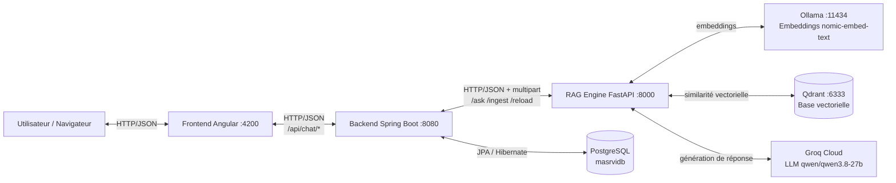
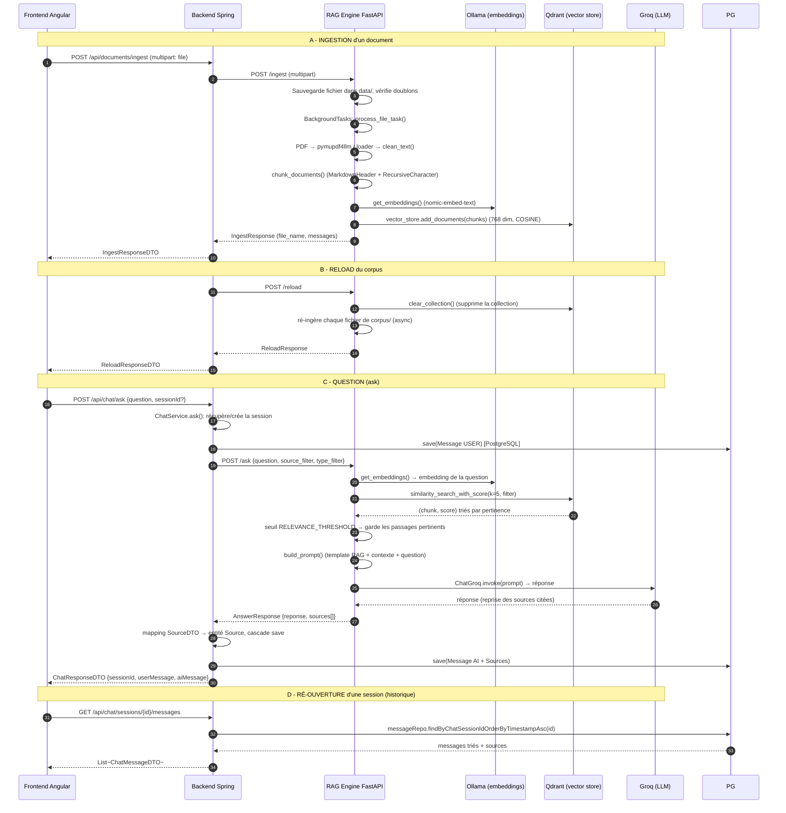

# Projet MASRVI — Dossier de présentation complet pour la validation de stage

> Assistant RAG documentaire : **Angular (frontend)** + **Spring Boot (backend)** + **FastAPI (moteur RAG)** + **Qdrant (base vectorielle)** + **Ollama (embeddings)** + **Groq (LLM)** + **PostgreSQL (persistance)**.

---

## Table des matières

1. [Vue d'ensemble du système](#1-vue-densemble-du-système)
2. [Diagramme de classes UML (backend Spring)](#2-diagramme-de-classes-uml-backend-spring)
3. [Le pipeline RAG complet](#3-le-pipeline-rag-complet)
4. [Le frontend Angular : envoie, reçoit, affiche](#4-le-frontend-angular)
5. [Le backend Spring : démarrage, beans, injections, flux](#5-le-backend-spring)
6. [Les technologies du projet : définitions et rôles](#6-les-technologies-du-projet)
7. [Choix technologiques Spring](#7-choix-technologiques-spring)
8. [Les structures de données : définition, rôle, paramètres](#8-les-structures-de-données)
9. [Lombok : les fonctions générées](#9-lombok-les-fonctions-générées)
10. [Les builders et les streams : définitions et usages](#10-les-builders-et-les-streams)
11. [Les exceptions et leurs rôles](#11-les-exceptions-et-leurs-rôles)
12. [Connexion RAG ↔ Qdrant, Ollama, Groq](#12-connexion-rag--qdrant-ollama-groq)
13. [Logique métier du frontend : placement et mémorisation](#13-logique-métier-du-frontend)

---

## 1. Vue d'ensemble du système

Le projet est une application **3 tiers** avec un moteur RAG *séparé* (FastAPI), ce qui
découple l'IA de l'API de persistance.



**Rôles :**
- **Frontend (Angular)** : interface utilisateur ; envoie les questions et reçoit les réponses JSON.
- **Backend (Spring Boot)** : *orchestrateur* — expose l'API REST au frontend, **persiste** les
  conversations dans PostgreSQL, et fait *proxy* vers le moteur RAG.
- **RAG Engine (FastAPI)** : l'intelligence — ingère les documents dans Qdrant, fait la recherche
  sémantique et génère la réponse via Groq.
- **PostgreSQL** : mémoire durable des sessions, messages et sources (d'où la *mémorisation*
  des conversations : elles sont en base, pas dans le navigateur).
- **Qdrant** : stockage vectoriel des « chunks » de documents (embeddings).
- **Ollama** : modèle d'embeddings local (`nomic-embed-text`, 768 dimensions).
- **Groq** : LLM cloud (`qwen/qwen3.8-27b`) qui rédige la réponse à partir du contexte.

---

## 2. Diagramme de classes UML (backend Spring)

### 2.1 Convention UML utilisée dans le diagramme

| Symbole | Signification | Exemple dans le projet |
|---|---|---|
| **◆ Composition** (`*--`, losange plein) | Le *tout* possède la *partie* ; la partie n'existe pas sans le tout (cycle de vie lié, destruction en cascade). | `ChatSession` **compose** ses `Message` ; `Message` **compose** ses `Source`. |
| **◇ Agrégation** (`o--`, losange vide) | Le *tout* référence des *parties* qui peuvent exister indépendamment. | Non présente dans ce modèle (toutes les parties ont un cycle de vie lié via FK `NOT NULL` + `orphanRemoval`). |
| **Association** (`-->`, trait plein) | Lien structurel navigable entre classes (avec multiplicités). | `Message` → `ChatSession` (`@ManyToOne`), `Source` → `Message`. |
| **Dépendance** (`..>`, pointillés) | Une classe *utilise* une autre (paramètre, retour, injection). | `ChatService` → repositories ; Controllers → service. |
| **Réalisation** (`<|..`, pointillés + triangle) | Une classe implémente une interface. | Repositories → `JpaRepository`. |
| **Généralisation** (`<|--`, trait plein + triangle) | Héritage. | `RagEngineException` hérite de `RuntimeException`. |

> Pourquoi pas d'agrégation ici : en JPA, `messages` et `sources` sont des relations
> **bidirectionnelles avec `cascade = ALL` + `orphanRemoval = true`** et une clé étrangère
> `NOT NULL`. La partie ne peut pas vivre sans son tout → c'est bien une **composition**,
> pas une agrégation. Le seul cas de lien structurel simple est l'association `@ManyToOne`.

### 2.2 Diagramme complet

```mermaid
classDiagram
    %% ===== Entités (couche persistance) =====
    class ChatSession {
        -Long id
        -String title
        -LocalDateTime createdAt
        -String createdBy
        +onCreate() void
    }
    class Message {
        -Long id
        -String role
        -String content
        -LocalDateTime timestamp
        -ChatSession chatSession
        +onCreate() void
    }
    class Source {
        -Long id
        -String documentName
        -Integer page
        -String section
        -Double score
        -Message message
    }
    class DocumentMetadata {
        -Long id
        -String filename
        -LocalDateTime uploadDate
        -String status
        -String department
        -DocumentVisibility visibility
        -List~String~ allowedDepartments
        +onCreate() void
    }
    class DocumentVisibility {
        <<enumeration>>
        PUBLIC
        DEPARTMENT
        RESTRICTED
    }

    %% ===== Repositories (réalisation de JpaRepository) =====
    class JpaRepository~T, ID~ {
        <<interface>>
        +save(entity T) T
        +findById(id ID) Optional~T~
        +findAll() List~T~
        +delete(entity T) void
    }
    class ChatSessionRepository {
        <<interface>>
        +findByCreatedBy(createdBy String) List~ChatSession~
    }
    class MessageRepository {
        <<interface>>
        +findByChatSessionIdOrderByTimestampAsc(sessionId Long) List~Message~
    }
    class DocumentMetadataRepository {
        <<interface>>
    }

    %% ===== Service (cœur) =====
    class ChatService {
        -DEFAULT_USER String
        -ChatSessionRepository sessionRepo
        -MessageRepository messageRepo
        -RagEngineClient ragClient
        +ask(request AskRequestDTO) ChatResponseDTO
        +getAllSessions() List~ChatSessionSummaryDTO~
        +getSessionMessages(sessionId Long) List~ChatMessageDTO~
        -toDTO(m Message) ChatMessageDTO
    }

    %% ===== Client RAG =====
    class RagEngineClient {
        -RestClient ragRestClient
        +ask(question String, sourceFilter String, typeFilter String) RagResponse
        +reload() ReloadResponseDTO
        +ingest(file MultipartFile, department String, visibility String, allowedDepartments List~String~) IngestResponseDTO
        -execute(request RequestHeadersSpec, responseType Class) T
        -isError(status HttpStatusCode) boolean
        -handleError(request HttpRequest, response ClientHttpResponse) void
    }
    class RagResponse {
        <<inner class @Data>>
        -String reponse
        -List~SourceDTO~ sources
    }

    %% ===== Controllers (couche HTTP) =====
    class ChatController {
        -ChatService chatService
        +ask(request AskRequestDTO) ResponseEntity~ChatResponseDTO~
    }
    class ChatSessionController {
        -ChatService chatService
        +getAllSessions() ResponseEntity~List~ChatSessionSummaryDTO~~
        +getSessionMessages(id Long) ResponseEntity~List~ChatMessageDTO~~
    }
    class DocumentController {
        -RagEngineClient ragClient
        +reload() ResponseEntity~ReloadResponseDTO~
        +ingest(file MultipartFile, department String, visibility String, allowedDepartments List~String~) ResponseEntity~IngestResponseDTO~
    }

    %% ===== Config (beans) =====
    class CorsConfig {
        -String frontendUrl
        +corsConfigurer() WebMvcConfigurer
    }
    class RestClientConfig {
        +ragRestClient(builder RestClient.Builder, ragEngineUrl String) RestClient
    }
    class RestClient {
        <<Spring 6>>
    }

    %% ===== Exceptions =====
    class RuntimeException {
        <<java.lang>>
    }
    class RagEngineException {
        +RagEngineException(message String)
        +RagEngineException(message String, cause Throwable)
    }
    class EntityNotFoundException {
        <<jakarta.persistence>>
    }
    class GlobalExceptionHandler {
        +handleRagEngineException(ex RagEngineException) ResponseEntity~Object~
        +handleEntityNotFoundException(ex EntityNotFoundException) ResponseEntity~Object~
    }

    %% ===== DTOs =====
    class AskRequestDTO {
        <<record>>
        -Long sessionId
        -String question
        -String sourceFilter
        -String typeFilter
    }
    class ChatResponseDTO {
        <<record>>
        -Long sessionId
        -ChatMessageDTO userMessage
        -ChatMessageDTO aiMessage
    }
    class ChatMessageDTO {
        <<record>>
        -Long id
        -String role
        -String content
        -LocalDateTime timestamp
        -List~SourceDTO~ sources
    }
    class SourceDTO {
        <<record>>
        -String documentName
        -Integer page
        -Double score
        -String section
    }
    class ChatSessionSummaryDTO {
        <<@Data @Builder>>
        -Long id
        -String title
        -LocalDateTime createdAt
        -int messageCount
    }
    class IngestResponseDTO {
        <<record>>
        -String fileName
        -Integer nbPassages
        -String messages
    }
    class ReloadResponseDTO {
        <<record>>
        -String messages
    }

    %% ===== Relations UML =====
    %% Compositions (losange plein) : le tout possède la partie
    ChatSession "1" *-- "0..*" Message : compose
    Message "1" *-- "0..*" Source : compose

    %% Associations bidirectionnelles (navigables depuis la partie)
    Message "0..*" --> "1" ChatSession : session (@ManyToOne)
    Source "0..*" --> "1" Message : message (@ManyToOne)

    %% Composition de la classe interne
    RagEngineClient "1" *-- "1" RagResponse : classe interne

    %% Réalisations (interfaces)
    ChatSessionRepository <|.. JpaRepository~ChatSession, Long~
    MessageRepository <|.. JpaRepository~Message, Long~
    DocumentMetadataRepository <|.. JpaRepository~DocumentMetadata, Long~

    %% Généralisation (héritage)
    RuntimeException <|-- RagEngineException

    %% Dépendances (le service utilise les repos, le client, les DTO)
    ChatService ..> ChatSessionRepository : utilise
    ChatService ..> MessageRepository : utilise
    ChatService ..> RagEngineClient : utilise
    ChatService ..> AskRequestDTO
    ChatService ..> ChatResponseDTO
    ChatService ..> ChatMessageDTO
    ChatService ..> ChatSessionSummaryDTO
    ChatService ..> SourceDTO
    ChatService ..> EntityNotFoundException : lève
    ChatController ..> ChatService : injecte
    ChatSessionController ..> ChatService : injecte
    DocumentController ..> RagEngineClient : injecte
    ChatController ..> AskRequestDTO
    ChatController ..> ChatResponseDTO
    ChatSessionController ..> ChatSessionSummaryDTO
    ChatSessionController ..> ChatMessageDTO
    DocumentController ..> ReloadResponseDTO
    DocumentController ..> IngestResponseDTO
    RagEngineClient ..> IngestResponseDTO
    RagEngineClient ..> ReloadResponseDTO
    RagEngineClient ..> SourceDTO
    RagEngineClient --> RestClient : utilise
    RagEngineClient ..> RagEngineException : lève
    RestClientConfig ..> RestClient : crée (@Bean)
    GlobalExceptionHandler ..> RagEngineException : gère
    GlobalExceptionHandler ..> EntityNotFoundException : gère
    DocumentMetadata --> DocumentVisibility : utilise
```



### 2.3 Correspondance code JPA ↔ éléments UML

| Code JPA | Élément UML | Justification |
|---|---|---|
| `@OneToMany(mappedBy = "chatSession", cascade = ALL, orphanRemoval = true)` | **Composition** `ChatSession ◆— Message` | Les messages n'existent pas sans leur session (FK `NOT NULL`), supprimés en cascade, retirés de la liste → supprimés (`orphanRemoval`). |
| `@OneToMany(mappedBy = "message", cascade = ALL, orphanRemoval = true)` | **Composition** `Message ◆— Source` | Même logique : les sources appartiennent au message AI. |
| `@ManyToOne` + `@JoinColumn(nullable = false)` | **Association** `Message → ChatSession` (`0..*` ↔ `1`) | Navigable du côté « plusieurs » ; la partie référence son tout sans le posséder. |
| `extends JpaRepository<Entity, Long>` | **Réalisation** (`<|..`) | Les interfaces héritent des méthodes CRUD de Spring Data. |
| Champ `private final ChatSessionRepository ...` | **Dépendance / injection** | Le service utilise les repositories (injection par constructeur). |
| `@RestController` champ `private final ChatService chatService` | **Dépendance** `Controller ..> Service` | Le controller délègue au service. |
| `extends RuntimeException` | **Généralisation** (`<|--`) | `RagEngineException` est une exception *non contrôlée*. |
| `@Configuration` + `@Bean` | **Dépendance** `Config ..> Bean` | La configuration *crée* des beans (`RestClient`, `WebMvcConfigurer`). |

### 2.4 Explication des choix de conception

| Choix | Pourquoi |
|---|---|
| **Couche Controller/Service/Repository** | Séparation stricte des responsabilités : les controllers ne contiennent **aucune** logique métier, ils ne font que `ResponseEntity.ok(...)`. Testabilité et maintenance accrues. |
| **`@RestController` + `@RequestMapping`** | Déclare une API REST : `@RestController` = `@Controller` + sérialisation JSON automatique des retours. `@RequestMapping` factorise le préfixe d'URL. |
| **`@Service`, `@Component`, `@Configuration`** | Stéréotypes Spring : marquent des **beans** (objets gérés par le conteneur) de type service, composant, configuration. |
| **Entités JPA** (`@Entity`, `@Table`) | Mapping objet ↔ relationnel : chaque classe = une table, chaque champ = une colonne. |
| **`@Getter @Setter @Builder @ToString @EqualsAndHashCode`** | Lombok génère le code répétitif à la compilation (voir §9). |
| **Relations `@OneToMany` / `@ManyToOne`** | Modélisent le schéma : une session → plusieurs messages → plusieurs sources. `mappedBy` désigne le côté propriétaire. |
| **`FetchType.LAZY`** | Ne charge les collections que si besoin → pas de requêtes inutiles (performance). |
| **`cascade = ALL` + `orphanRemoval = true`** | Sauvegarde automatique des enfants (Message → Source) et suppression des enfants retirés de la liste → **composition** en UML. |
| **`record` pour les DTO** | DTO = contrat immutable de transport (voir §7). |
| **`@Data @Builder` pour `ChatSessionSummaryDTO`** | Builder lisible quand il y a plusieurs champs ; `@Data` pour getters/toString. |
| **`@ControllerAdvice`** | Gestion globale des exceptions → réponse JSON uniforme (voir §11). |
| **`RagEngineClient` (proxy HTTP)** | Isole toute la logique HTTP vers le RAG dans un composant unique, avec timeouts et gestion d'erreurs centralisée. |
| **`@RequiredArgsConstructor`** | Injection **par constructeur** (dépendances `final`), meilleure pratique vs `@Autowired` par champ. |

---

## 3. Le pipeline RAG complet

### 3.1 Diagramme de flux (de bout en bout)



### 3.2 Technologies utilisées

| Technologie | Rôle dans le pipeline |
|---|---|
| **FastAPI + Uvicorn** | Serveur HTTP Python exposant `/ask`, `/ingest`, `/reload`, `/health`. |
| **Qdrant** | Base vectorielle (similarité cosinus, 768 dimensions). |
| **Ollama + `nomic-embed-text`** | Génération locale des embeddings (question + documents). |
| **Groq + `qwen/qwen3.8-27b`** | LLM cloud qui génère la réponse finale (`temperature=0` → fidélité). |
| **`pymupdf4llm`** | Conversion PDF → texte structuré (Markdown) page par page. |
| **LangChain** | `TextLoader`, `Docx2txtLoader`, `BSHTMLLoader`, `MarkdownHeaderTextSplitter`, `RecursiveCharacterTextSplitter`, `QdrantVectorStore`. |
| **Pydantic** | Modèles de validation des requêtes/réponses (`QuestionRequest`, `AnswerResponse`...). |

*(Chaque technologie est définie et expliquée en détail dans la section [6](#6-les-technologies-du-projet).)*

### 3.3 Les méthodes de chaque étape (code réel)

**Étape 1 — Extraction (lecture des fichiers)**
- `core/process_document.py::get_loader()` : choisit le loader selon l'extension
  (`.txt/.md` → `TextLoader`, `.docx` → `Docx2txtLoader`, `.html/.htm` → `BSHTMLLoader`).
- PDF : `pymupdf4llm.to_markdown(filepath, page_chunks=True)` → un document par page avec `metadata.page`.
- `clean_text()` : normalise les espaces multiples et les sauts de ligne.

**Étape 2 — Découpage (chunking) — `retrieval/semantic_chunker.py::chunk_documents()`**
- `MarkdownHeaderTextSplitter(["#","##","###"])` : repère les titres et les garde en mémoire
  entre les pages (un split sans titre hérite des titres de la page précédente).
- `RecursiveCharacterTextSplitter.from_language(Language.MARKDOWN, chunk_size=1000, chunk_overlap=200)` :
  découpe en morceaux de ~1000 caractères avec 200 de chevauchement, sans casser les tableaux/listes.

**Étape 3 — Enrichissement des métadonnées** (`process_file_task`)
- `metadata["type"]` = extension (`pdf`, `txt`...).
- `metadata["department"]`, `metadata["visibility"]`, `metadata["allowed_departments"]` : contrôle d'accès.
- `metadata["section"]` : titre extrait des headers (le plus profond, nettoyé du Markdown).

**Étape 4 — Déduplication** (`retrieval/qdrant_client.py`)
- `delete_document(basename)` : supprime les anciens chunks du document via un filtre Qdrant sur
  `metadata.source` avant ré-ingestion.
- `document_exists(basename)` : garde anti-doublon au niveau API (refus si déjà dans le corpus).

**Étape 5 — Indexation vectorielle** (`get_vector_store()`)
- `QdrantClient(url)` + création de la collection si absente :
  `VectorParams(size=768, distance=Distance.COSINE)`.
- `QdrantVectorStore(...).add_documents(chunks)` : Ollama calcule chaque embedding,
  Qdrant les stocke en points.

**Étape 6 — Recherche sémantique** (`search_passages()`)
- `similarity_search_with_score(question, k=SEARCH_K=5, filter=...)` : embedding de la question
  puis recherche des 5 plus proches voisins (COSINE).
- Construction du `Filter` Qdrant : `source_filter` → `metadata.source`, `type_filter` →
  `metadata.type`, et un bloc `should` pour la **visibilité** (PUBLIC / DEPARTMENT / RESTRICTED).

**Étape 7 — Seuil de pertinence** (`core/exchange.py::generate_answer()`)
- Si `resultats[0][1] < RELEVANCE_THRESHOLD` → réponse par défaut
  « Je n'ai pas trouvé d'information pertinente » (pas d'hallucination).

**Étape 8 — Construction du prompt** (`build_prompt()`)
- Template RAG strict : fidélité au contexte, citation des sources `[Nom_Doc, Page X]`,
  gestion de l'incertitude, format Markdown.

**Étape 9 — Génération** (`utils/clients.py::get_llm()`)
- `ChatGroq(model=LLM_MODEL, api_key=GROQ_API_KEY, temperature=0)` → `llm.invoke(prompt)`.
- Les `SourceItem` sont construits avec `document_name`, `page`, `score` (arrondi à 3), `section`.

**Étape 10 — Réponse au backend**
- `AnswerResponse` → Spring re-mappe en entités `Source` et persiste tout (cascade).

---

## 4. Le frontend Angular

### 4.1 Stack
- **Angular 21** (composants **standalone**, signaux `signal()`, contrôle de flux `@for/@if`).
- **RxJS** (`Observable`, `subscribe`) pour les appels HTTP.
- **`HttpClient`** via `provideHttpClient()` dans `app.config.ts`.
- Pas de routing actif (`routes: []`) : application mono-vue.

### 4.2 Le service `ChatService` : qu'est-ce qu'il envoie / reçoit

`src/app/services/chat.service.ts` — point d'entrée HTTP vers le backend (`http://localhost:8080`).

| Méthode | Envoie | Reçoit | Endpoint |
|---|---|---|---|
| `ask(request: AskRequestDTO)` | `POST` JSON `{sessionId?, question, sourceFilter?, typeFilter?}` | `ChatResponseDTO` | `/api/chat/ask` |
| `getSessions()` | `GET` (rien) | `ChatSessionSummaryDTO[]` | `/api/chat/sessions` |
| `getSessionMessages(sessionId)` | `GET` (id dans l'URL) | `ChatMessageDTO[]` | `/api/chat/sessions/{id}/messages` |

Les interfaces TypeScript (`models/api.models.ts`) **miment exactement** les DTO Java :
`SourceDTO`, `ChatMessageDTO` (`role: 'USER' | 'AI'`), `ChatResponseDTO`, `AskRequestDTO`,
`ChatSessionSummaryDTO`.

### 4.3 Les composants et « où s'affiche quoi »

| Composant | Emplacement (layout) | Rôle |
|---|---|---|
| `App` (`app.ts/html`) | Racine | Ouvre le layout `flex` : `sidebar` à gauche, `chat-area` à droite. Porte l'état `activeSessionId`. |
| `SidebarComponent` | **Gauche** | Logo MASRVI, bouton « Nouvelle discussion », liste de l'**historique des sessions** (titre + date). |
| `ChatAreaComponent` | **Centre** | En-tête, liste des messages (scroll auto), barre de saisie. |
| `ChatMessageComponent` | **Centre (un bloc par message)** | Bulle USER (droite) ou AI (gauche), et **sous chaque message AI** : le bloc `Sources`. |
| `SourceCardComponent` | **Sous la bulle AI, en bas du message** | Une carte par source : nom du document, `p. X`, section, score en `%`. |

### 4.4 Logique métier du frontend (qui appelle quoi)

- **`SidebarComponent.ngOnInit()`** → `loadSessions()` → `ChatService.getSessions()` →
  remplit `sessions` signal (liste à gauche).
- **`onNewChat()`** (bouton « Nouvelle discussion ») → émet `newChat` → `App.onNewChat()` →
  `activeSessionId = null` → `ChatAreaComponent` affiche le **message de bienvenue**.
- **`onSessionClick(id)`** → émet `sessionSelected` → `App.onSessionSelected(id)` →
  `ChatAreaComponent` reçoit `sessionId` (`@Input`) → `ngOnChanges` → `loadSessionMessages(id)`.
- **`ChatAreaComponent.onSend()`** :
  1. Vérifie question non vide et pas déjà en chargement.
  2. Affiche **immédiatement** la bulle utilisateur (UI optimiste).
  3. Appelle `chatService.ask(...)`.
  4. À la réponse : si c'était une nouvelle session (`sessionId == null`), récupère
     `res.sessionId` → émet `sessionCreated` → `App.onSessionCreated(id)` → recharge la liste
     des sessions et active la session dans la sidebar.
  5. Ajoute la bulle AI + ses sources, scroll en bas.
- **`mapDto(dto)`** : convertit `ChatMessageDTO` (backend) → `UiMessage` local, formate le
  timestamp (`HH:mm`), garantit `sources` en tableau (jamais `null`).

### 4.5 Comment les sources s'affichent « en bas »

Dans `chat-message.html`, le bloc sources est **à l'intérieur du message AI**, après la bulle :
```html
@if (!isUser && message.sources && message.sources.length > 0) {
  <div class="sources-container">
    <span class="sources-label">Sources</span>
    <div class="sources-list">
      @for (source of message.sources; track source.documentName) {
        <app-source-card [source]="source" />
      }
    </div>
  </div>
}
```
La carte (`source-card`) affiche nom + `p. X` + section + score en `%` (calculé par
`scorePercent` = `Math.round(score * 100) + '%'`).

### 4.6 Pourquoi les conversations sont-elles « mémorisées » ? (PostgreSQL)

Parce que **le frontend ne stocke rien en local** (pas de `localStorage`). Chaque session,
message et source est **persisté par le backend dans PostgreSQL** :
- le premier `ask()` **crée** la session (si pas de `sessionId`) et la sauvegarde ;
- la sidebar recharge la liste depuis `GET /api/chat/sessions` (lues en base) ;
- ré-ouvrir une session = `GET /api/chat/sessions/{id}/messages` (lues en base).
→ Recharger le navigateur ne perd rien : l'historique vit dans PostgreSQL.

---

## 5. Le backend Spring

### 5.1 Que se passe-t-il quand on lance `mvn spring-boot:run` ?

1. Maven compile le projet (Java 17) et lance `MasrviCoreApplication.main()`.
2. `@SpringBootApplication` active trois mécanismes : configuration automatique
   (`@EnableAutoConfiguration`), détection des composants du package `com.masrvi.core`
   (`@ComponentScan`) et configuration Spring (`@Configuration`).
3. Le **conteneur Spring (ApplicationContext)** scanne les packages et **crée les beans** :
   - `@RestController` → `ChatController`, `ChatSessionController`, `DocumentController` ;
   - `@Service` → `ChatService` ;
   - `@Component` → `RagEngineClient` ;
   - `@Configuration` + `@Bean` → `corsConfigurer()`, `ragRestClient` (`RestClientConfig`) ;
   - `@ControllerAdvice` → `GlobalExceptionHandler`.
4. **Injection de dépendances** (par constructeur, grâce à `@RequiredArgsConstructor`) :
   - Spring injecte `ChatSessionRepository`, `MessageRepository`, `RagEngineClient` dans `ChatService` ;
   - injecte `ChatService` dans `ChatController` et `ChatSessionController` ;
   - injecte `RagEngineClient` dans `DocumentController` ;
   - injecte `RestClient` dans `RagEngineClient` (bean créé par `RestClientConfig`) ;
   - injecte `frontendUrl` (`@Value("${masrvi.frontend.url}")`) dans `CorsConfig`.
5. **Spring Data JPA** : `RepositoryConfigurationDelegate` instancie les implémentations des
   interfaces `JpaRepository` (`ChatSessionRepository`, `MessageRepository`,
   `DocumentMetadataRepository`) — Spring génère le code à partir du nom des méthodes
   (requêtes dérivées).
6. **Hibernate** démarre l'`EntityManagerFactory` : lit `application.properties`, se connecte à
   PostgreSQL, et avec `ddl-auto=update` **synchronise le schéma** (ajoute colonnes/tables
   manquantes). Le pool de connexions **HikariCP** est initialisé.
7. **Tomcat** démarre sur le port 8080 et expose les endpoints → l'application répond.

> Beans créés « et consommés » : chaque requête HTTP arrive sur un controller (bean
> singleton), qui appelle le service (bean), qui utilise les repositories (proxy Spring Data)
> et le client RAG (bean). Tous sont **singletons** par défaut.

### 5.2 Les annotations du backend (récapitulatif)

| Annotation | Où | Rôle |
|---|---|---|
| `@SpringBootApplication` | `MasrviCoreApplication` | Point d'entrée : auto-config + scan + configuration. |
| `@RestController` | Controllers | Bean REST qui sérialise les retours en JSON. |
| `@RequestMapping("/api/chat")` | Controllers | Préfixe commun des URLs. |
| `@PostMapping`, `@GetMapping` | Controllers | Associe méthode HTTP + chemin. |
| `@RequestBody`, `@RequestParam`, `@PathVariable` | Controllers | Lient corps/paramètres de requête aux arguments. |
| `@Service`, `@Component`, `@Configuration` | Divers | Stéréotypes : enregistrent un bean. |
| `@RequiredArgsConstructor` | Service/Controllers | Génère un constructeur pour les champs `final` → injection. |
| `@Bean` | `CorsConfig`, `RestClientConfig` | Déclare un bean créé par une méthode. |
| `@Value("${...}")` | Config | Injection d'une propriété depuis `application.properties`. |
| `@Transactional(readOnly = true)` | `ChatService` | Transaction en lecture seule (lecture + lazy + performance). |
| `@Entity`, `@Table`, `@Column`, `@Id`, `@GeneratedValue` | Entités | Mapping JPA. |
| `@OneToMany`, `@ManyToOne`, `@JoinColumn` | Entités | Relations JPA. |
| `@PrePersist` | Entités | Hook avant insertion (auto-remplit les dates). |
| `@Enumerated(EnumType.STRING)`, `@ElementCollection` | `DocumentMetadata` | Enum stockée en texte, liste en table séparée. |
| `@ControllerAdvice`, `@ExceptionHandler` | `GlobalExceptionHandler` | Gestion globale des exceptions. |
| `@Getter @Setter @ToString @EqualsAndHashCode @NoArgsConstructor @AllArgsConstructor @Builder` | Entités/DTO | Génération Lombok. |

### 5.3 Qui envoie quoi à qui (flux de données)

- **Frontend → Backend** : JSON des DTO (`AskRequestDTO`) ou multipart (ingestion) via HTTP.
- **Backend → Frontend** : JSON des DTO (`ChatResponseDTO`, `List<ChatSessionSummaryDTO>`,
  `List<ChatMessageDTO>`, `IngestResponseDTO`, `ReloadResponseDTO`). Le backend **mappe
  toujours les entités en DTO** avant de répondre (jamais d'entité sérialisée).
- **Backend → RAG** : `RagEngineClient` envoie JSON (`/ask`, `/reload`) ou multipart (`/ingest`).
- **RAG → Backend** : JSON typé (désérialisé dans `RagResponse`, `IngestResponseDTO`,
  `ReloadResponseDTO`).
- **Backend → PostgreSQL** : via les repositories JPA (SQL généré par Hibernate).
- **Backend → Frontend (ingestion)** : proxy direct du JSON Python vers Angular.

### 5.4 Comment le backend reçoit, traite et renvoie

1. **Reçoit** : `@RequestBody AskRequestDTO request` — Jackson désérialise le JSON en record.
2. **Traite** : `ChatService.ask()` — 5 étapes : session → message USER → appel RAG →
   message AI + sources → DTO.
3. **Envoie** : Jackson **sérialise** le record `ChatResponseDTO` en JSON (accesseurs `x()`).
4. **Erreurs** : si le RAG est down → `RagEngineException` → `GlobalExceptionHandler` → HTTP 503 ;
   session inexistante → `EntityNotFoundException` → HTTP 404.

### 5.5 Schéma de la base de données

```mermaid
erDiagram
    chat_sessions ||--o{ messages : "contient"
    messages ||--o{ sources : "contient"

    chat_sessions {
        bigint id PK
        varchar(255) title
        timestamp created_at "NOT NULL (auto @PrePersist)"
        varchar(255) created_by "NOT NULL"
    }
    messages {
        bigint id PK
        varchar(255) role "USER|AI"
        text content "NOT NULL"
        timestamp timestamp "NOT NULL (auto @PrePersist)"
        bigint session_id FK "NOT NULL"
    }
    sources {
        bigint id PK
        varchar(255) document_name "NOT NULL"
        integer page
        varchar(255) section
        double precision score
        bigint message_id FK "NOT NULL"
    }
    documents {
        bigint id PK
        varchar(255) filename "NOT NULL"
        timestamp upload_date "NOT NULL"
        varchar(255) status "PROCESSING|INDEXED|ERROR"
        varchar(255) department
        varchar(255) visibility "PUBLIC|DEPARTMENT|RESTRICTED"
    }
    document_allowed_departments {
        bigint document_id FK
        varchar(255) department_name
    }
```

### 5.6 Comment JPA / Hibernate travaille

- **Mapping** : chaque entité → table, chaque champ → colonne (nom camelCase → snake_case par défaut).
- **Requêtes dérivées** : `findByCreatedBy(...)`, `findByChatSessionIdOrderByTimestampAsc(...)` →
  Spring Data parse le nom de méthode et génère le SQL.
- **EntityManager + transactions** : chaque méthode `@Transactional` ouvre une transaction ;
  `save()` → `INSERT`, les entités modifiées → `UPDATE` (dirty checking), les supprimées → `DELETE`.
- **Cascade** : `save(aiMessage)` avec `cascade = ALL` sur `sources` → Hibernate insère le
  message **puis** les sources (transaction implicite du repository).
- **`@PrePersist`** : avant le `INSERT`, Hibernate appelle `onCreate()` qui remplit
  `createdAt`/`timestamp`/`uploadDate`.
- **`ddl-auto=update`** : au démarrage, Hibernate compare le schéma et l'ajuste
  (ajoute colonnes manquantes) ; il ne supprime jamais de colonne (d'où les migrations SQL manuelles).
- **Lazy loading** : les collections `messages`/`sources` sont chargées à la demande —
  c'est pour ça que `getAllSessions()` et `getSessionMessages()` sont `@Transactional`
  (sinon `LazyInitializationException` hors session).

---

## 6. Les technologies du projet

Chaque technologie est définie, puis son **rôle précis dans le projet** et ses **points d'usage**
sont expliqués.

### 6.1 Java 17
- **Définition** : langage orienté objet, à exécution sur machine virtuelle (JVM). Compilé en
  bytecode par `javac`. La version 17 (LTS) apporte notamment les **records** et les **streams**.
- **Rôle dans le projet** : tout le backend est écrit en Java 17 (`pom.xml` → `<java.version>17`).
- **Points d'usage** :
  - **Records** pour les DTO (voir §7) ;
  - **API Stream** pour les transformations de listes (voir §10) ;
  - `Optional`, `LocalDateTime`, `List`, `Map`, génériques (`List<SourceDTO>`).

### 6.2 Maven
- **Définition** : outil de *build* et de gestion de dépendances. Lit un fichier `pom.xml`
  qui décrit le projet, les dépendances (avec versions héritées d'un parent) et les plugins.
- **Rôle dans le projet** : télécharge les dépendances (Spring, JPA, PostgreSQL, Lombok…),
  compile, et lance l'application via `mvn spring-boot:run`.
- **Points d'usage** : parent `spring-boot-starter-parent:3.3.2` (versions cohérentes),
  dépendances `spring-boot-starter-web`, `spring-boot-starter-data-jpa`, `postgresql`
  (scope `runtime`), `lombok` (scope `optional`), plugin `spring-boot-maven-plugin`
  (exclut Lombok du jar final).

### 6.3 Spring Boot 3.3.2
- **Définition** : framework qui **auto-configure** une application Spring (serveur embarqué,
  JSON, JPA, etc.) à partir des dépendances présentes, et la lance par une simple classe `main`.
- **Rôle dans le projet** : socle du backend : serveur **Tomcat embarqué** (port 8080),
  parsing JSON (Jackson), gestion JPA, pool Hikari, propriétés dans `application.properties`.
- **Points d'usage** : `@SpringBootApplication`, starters `web` et `data-jpa`,
  `spring.jpa.hibernate.ddl-auto=update`, `spring.datasource.*`, `rag.engine.url`,
  `masrvi.frontend.url`.

### 6.4 Spring MVC (module web)
- **Définition** : module qui implémente le patron **MVC** pour le web : `Controller` →
  `Service` → `View`. Ici pas de « vue » (API JSON pure).
- **Rôle dans le projet** : les `@RestController` mappent les URLs HTTP vers des méthodes
  Java ; Jackson sérialise/désérialise automatiquement le JSON.
- **Points d'usage** : `@PostMapping("/ask")`, `@RequestBody AskRequestDTO`,
  `ResponseEntity.ok(...)` (permet de contrôler le statut HTTP).

### 6.5 Spring Data JPA
- **Définition** : abstraction de Spring sur **JPA** : on déclare des **interfaces** de
  repositories et Spring **génère l'implémentation** (proxy) ainsi que les requêtes SQL.
- **Rôle dans le projet** : `ChatSessionRepository`, `MessageRepository`,
  `DocumentMetadataRepository` étendent `JpaRepository<Entité, Long>` → méthodes CRUD
  prêtes à l'emploi.
- **Points d'usage** : **requêtes dérivées** par le nom de méthode :
  - `findByCreatedBy(String createdBy)` → `SELECT * FROM chat_sessions WHERE created_by = ?` ;
  - `findByChatSessionIdOrderByTimestampAsc(Long sessionId)` → tri `ORDER BY timestamp ASC`.

### 6.6 Hibernate 6.5 (implémentation JPA)
- **Définition** : **ORM** (Object-Relational Mapping) : fait le pont entre les objets Java
  (`@Entity`) et les tables SQL, et gère les transactions, le cache, le chargement paresseux.
- **Rôle dans le projet** : persiste `ChatSession`, `Message`, `Source`, `DocumentMetadata` ;
  applique `@PrePersist`, les cascades, le lazy loading ; synchronise le schéma (`ddl-auto`).
- **Points d'usage** : `@Entity`, `@OneToMany(cascade=ALL, orphanRemoval=true)`,
  `@ManyToOne(fetch=LAZY)`, dialect `PostgreSQLDialect`.

### 6.7 HikariCP (pool de connexions)
- **Définition** : pool de connexions JDBC performant — réutilise des connexions déjà ouvertes
  au lieu d'en ouvrir une par requête.
- **Rôle dans le projet** : fournit les connexions PostgreSQL à Hibernate (utilisé par défaut
  par Spring Boot). Visible dans les logs : `HikariPool-1 - Start completed.`

### 6.8 PostgreSQL
- **Définition** : SGBD **relationnel** open source, SQL standard, ACID.
- **Rôle dans le projet** : base `masrvidb` qui **mémorise** les conversations
  (tables `chat_sessions`, `messages`, `sources`, `documents`).
- **Points d'usage** : connexion `jdbc:postgresql://localhost:5432/masrvidb`, contraintes
  `NOT NULL`, clés étrangères générées par JPA (`session_id`, `message_id`).

### 6.9 Jackson (JSON)
- **Définition** : bibliothèque Java de **sérialisation/désérialisation** JSON (objet ↔ JSON).
- **Rôle dans le projet** : convertit les `record` DTO en JSON pour le frontend, et le JSON
  reçu en objets Java ; gère le snake_case du RAG Python.
- **Points d'usage** :
  - `@JsonProperty("file_name")` / `@JsonProperty("nb_passages")` dans `IngestResponseDTO` :
    force le mapping des clés snake_case du moteur Python ;
  - `@JsonAlias("document_name")` dans `SourceDTO` : accepte les deux noms.

### 6.10 Lombok
- **Définition** : bibliothèque qui **génère du code Java à la compilation** (annotation
  processor) : getters, setters, constructeurs, builders, `equals`/`hashCode`/`toString`.
- **Rôle dans le projet** : réduit le code répétitif des entités et DTO.
- **Points d'usage** : voir §9 pour la liste complète des annotations et fonctions générées.

### 6.11 RestClient (Spring 6)
- **Définition** : client HTTP **fluent** de Spring pour appeler des API externes.
- **Rôle dans le projet** : `RagEngineClient` appelle le moteur RAG (`/ask`, `/ingest`,
  `/reload`) avec **timeouts explicites**.
- **Points d'usage** :
  - `RestClientConfig` : `setConnectTimeout(5000)`, `setReadTimeout(60000)`,
    `.baseUrl(ragEngineUrl)` ;
  - `request.retrieve().onStatus(...)` → gestion d'erreurs HTTP centralisée ;
  - `.body(Map)` (JSON), `.body(MultiValueMap)` (multipart).

### 6.12 Angular 21
- **Définition** : framework **frontend** TypeScript (SPA) : composants, injection de
  dépendances, templating, état réactif.
- **Rôle dans le projet** : interface du chatbot (sidebar + zone de chat + sources).
- **Points d'usage** : composants **standalone** (`standalone: true`), **signaux**
  (`signal<T>()`), contrôle de flux moderne `@if`/`@for`, communication
  **`@Input` / `output()`**, `provideHttpClient()`.

### 6.13 TypeScript
- **Définition** : sur-ensemble typé de JavaScript compilé en JS.
- **Rôle dans le projet** : les interfaces `api.models.ts` **reflètent** les DTO Java
  (même nommage, mêmes types) → typage de bout en bout de l'API.

### 6.14 RxJS
- **Définition** : bibliothèque de **programmation réactive** : `Observable`, `subscribe`.
- **Rôle dans le projet** : `HttpClient` retourne un `Observable<T>` ; les composants
  s'abonnent via `subscribe({ next, error })`.
- **Points d'usage** : `this.http.post<ChatResponseDTO>(url, body)`,
  `.subscribe({ next: (res) => {...}, error: () => {...} })`.

### 6.15 Python 3.11
- **Définition** : langage interprété, typage dynamique, très utilisé en IA/data.
- **Rôle dans le projet** : le moteur RAG (`FastAPI`, `langchain`, `qdrant-client`…).
- **Points d'usage** : modules `app/`, `core/`, `retrieval/`, `utils/`, `config.py`,
  gestion d'environnement via `.env`.

### 6.16 FastAPI + Uvicorn
- **Définition** : micro-framework **ASGI** Python à typage automatique (via Pydantic) ;
  **Uvicorn** est le serveur ASGI.
- **Rôle dans le projet** : expose les endpoints `/health`, `/ask`, `/ingest`, `/reload`.
- **Points d'usage** : `response_model=AnswerResponse` (validation automatique),
  `BackgroundTasks` (ingestion asynchrone), `UploadFile`/`Form` pour le multipart.

### 6.17 Pydantic
- **Définition** : bibliothèque de **validation de modèles** en Python (types, valeurs
  par défaut, conversion).
- **Rôle dans le projet** : modèles `QuestionRequest`, `AnswerResponse`, `SourceItem`,
  `IngestResponse`, `ReloadResponse` (`app/models.py`).
- **Points d'usage** : `Optional[str]`, `List[SourceItem] = []`, et `response_model` de FastAPI.

### 6.18 LangChain
- **Définition** : framework Python pour construire des applications **LLM** : chargement de
  documents, découpage, embeddings, vector stores, invocations de modèles.
- **Rôle dans le projet** : orchestration de tout le pipeline RAG côté Python.
- **Points d'usage** :
  - Loaders : `TextLoader(encoding="utf-8")`, `Docx2txtLoader`, `BSHTMLLoader` ;
  - Splitters : `MarkdownHeaderTextSplitter`, `RecursiveCharacterTextSplitter` ;
  - Vector store : `QdrantVectorStore` ; modèles : `OllamaEmbeddings`, `ChatGroq`.

### 6.19 pymupdf4llm
- **Définition** : bibliothèque qui convertit les **PDF en texte structuré Markdown**, page
  par page, en conservant titres et mise en page.
- **Rôle dans le projet** : `to_markdown(filepath, page_chunks=True)` produit une liste de
  pages (texte + `metadata.page`) pour les documents PDF du corpus.

### 6.20 Qdrant
- **Définition** : base de données **vectorielle** : stocke des vecteurs (embeddings) et
  répond aux requêtes de **plus proches voisins** (distance cosinus ici).
- **Rôle dans le projet** : collection `masrvi_docs` qui contient les chunks indexés.
- **Points d'usage** : `QdrantClient(url)`, `create_collection(VectorParams(size=768,
  distance=COSINE))`, `similarity_search_with_score(question, k=5, filter=...)`,
  filtres `Filter`/`FieldCondition`/`MatchValue`/`MatchAny`/`IsEmptyCondition`/`PayloadField`.

### 6.21 Ollama
- **Définition** : outil qui exécute des **modèles d'IA en local** (embeddings, LLM) et les
  expose sur une API locale.
- **Rôle dans le projet** : modèle d'embeddings `nomic-embed-text` (768 dimensions) pour
  vectoriser les documents et les questions (`OllamaEmbeddings`).
- **Points d'usage** : `config.USE_OLLAMA_EMBEDDINGS = true`, `OLLAMA_URL=http://localhost:11434`.

### 6.22 Groq
- **Définition** : API cloud de **LLM ultra-rapides** (puces LPU dédiées).
- **Rôle dans le projet** : le LLM qui **rédige les réponses** : `qwen/qwen3.8-27b`.
- **Points d'usage** : `ChatGroq(model=..., api_key=GROQ_API_KEY, temperature=0)` —
  la clé est lue depuis la variable d'environnement `GROQ_API_KEY` (`.env`), **jamais codée
  en dur** ; `temperature=0` → réponse déterministe (anti-hallucination).

### 6.23 python-dotenv
- **Définition** : charge un fichier `.env` dans les variables d'environnement.
- **Rôle dans le projet** : `config.py` lit `QDRANT_URL`, `COLLECTION_NAME`, `GROQ_API_KEY`,
  `OLLAMA_URL`, `EMBEDDING_MODEL`, `LLM_MODEL`, `SEARCH_K`, `RELEVANCE_THRESHOLD`, etc.
  (définition des paramètres du pipeline RAG).

### 6.24 docx2txt & BeautifulSoup (via LangChain)
- **Définition** : bibliothèques d'extraction de texte depuis les `.docx` et `.html`.
- **Rôle dans le projet** : loaders LangChain `Docx2txtLoader` et `BSHTMLLoader` pour les
  formats autres que PDF/TXT/MD.

---

## 7. Choix technologiques Spring

| Choix | Détail |
|---|---|
| **`record` pour les DTO** | Immuable, accesseurs générés (`question()`, pas `getQuestion()`), constructeur/`equals`/`hashCode`/`toString` fournis par le langage. Parfait pour un **contrat de transport** qui ne doit pas être modifié. |
| **Interface `JpaRepository`** | Zéro implémentation : Spring Data génère le proxy + SQL à partir des noms de méthodes. |
| **`@Data @Builder` pour `ChatSessionSummaryDTO`** | On veut un builder lisible (construction en plusieurs champs) → on sort du `record` quand la construction par builder est plus claire. |
| **Injection par constructeur** (`@RequiredArgsConstructor`) | Champs `final`, impossible de créer un service sans ses dépendances, facile à tester (Mockito). |
| **`RestClient` (Spring 6)** | Client HTTP moderne et fluide, avec timeouts (5 s / 60 s) pour ne jamais bloquer. |
| **`@Value`** | Externalisation de la config (`rag.engine.url`, `masrvi.frontend.url`) dans `application.properties`. |
| **Exceptions dédiées** | `RagEngineException` au lieu d'exceptions techniques brutes exposées au client. |
| **`@ControllerAdvice`** | Un seul endroit pour transformer les exceptions en `{timestamp, status, error, message}`. |
| **DTO systématiques** | Entités jamais exposées à l'extérieur (sécurité + forme stable de l'API). |

### Pourquoi `record` et pas une classe ?

- Un `record` est **immuable** (champs `final`, aucun setter) : un DTO de transport ne doit
  jamais être modifié après sa création → moins de bugs.
- Les accesseurs, constructeur, `equals`, `hashCode`, `toString` sont **générés par le langage**
  → beaucoup moins de code que Lombok.
- La signature déclarative (`AskRequestDTO(Long sessionId, String question, ...)`) **documente**
  le contrat API en une seule ligne.
- On garde une **classe** (`ChatSessionSummaryDTO` avec `@Data @Builder`) quand on veut un
  **builder fluide** et un DTO mutable pour un mapping à plusieurs étapes.

---

## 8. Les structures de données

Définition, rôle, paramètres et méthodes utilisées pour chaque structure rencontrée dans le code.

### 8.1 `List` (interface) / `ArrayList` (implémentation)
- **Définition** : collection **ordonnée et indexée** ; accepte les doublons et `null` ;
  accès par position (index) en temps constant pour `ArrayList`.
- **Rôle dans le projet** : modélise les relations « plusieurs » des entités
  (`List<Message>`, `List<Source>`), les résultats de requêtes et les listes de DTO.
- **Paramètres** : généricité → `List<Message>`, `List<ChatSessionSummaryDTO>`,
  `List<SourceDTO>`, `List<String>` (départements autorisés).
- **Méthodes utilisées** : `.size()` (compte des messages), `.isEmpty()` (test de vide),
  `.add()` (ajout, via la cascade JPA), `.stream()` (transformation), `.toList()`
  (collecte immuable), `new ArrayList<>()` avec `@Builder.Default` (jamais de collection `null`).

### 8.2 `Map<String, Object>` (implémentation `HashMap`)
- **Définition** : association **clé → valeur** ; clés uniques ; accès en **O(1)**
  (table de hachage) ; permet un contenu hétérogène (`Object`).
- **Rôle dans le projet** : (1) corps JSON **envoyé au RAG** dans `RagEngineClient.ask()`,
  (2) corps JSON **d'erreur** dans `GlobalExceptionHandler`.
- **Paramètres et clés** :
  - `ask()` : `put("question", question)`, `put("source_filter", ...)`, `put("type_filter", ...)`
    (seulement si non vides) → sérialisées en JSON par Jackson ;
  - `GlobalExceptionHandler` : `timestamp`, `status`, `error`, `message`.

### 8.3 `MultiValueMap<String, Object>` (implémentation `LinkedMultiValueMap`)
- **Définition** : variante de `Map` où **une clé porte une liste de valeurs** → idéale pour
  le format **multipart/form-data** (une clé peut apparaître plusieurs fois).
- **Rôle dans le projet** : corps de `POST /ingest` vers le RAG dans `RagEngineClient.ingest()`.
- **Paramètres et méthodes** : `.add("file", fileResource)` (le fichier en `ByteArrayResource`),
  `.add("department", department)`, `.add("visibility", visibility)`,
  `.add("allowed_departments", String.join(",", allowedDepartments))`.

### 8.4 `Optional<T>`
- **Définition** : conteneur qui **porte ou non une valeur** (évite les `null` non gérés) ;
  API déclarative (`ifPresent`, `orElse`, `orElseThrow`).
- **Rôle dans le projet** : résultat de `sessionRepo.findById(...)`.
- **Paramètres et usage** : `findById(request.sessionId()).orElseThrow(() ->
  new EntityNotFoundException("..."))` — le *Supplier* de l'exception n'est exécuté que si
  l'`Optional` est vide.

### 8.5 `List<SourceDTO>` (dans `ChatMessageDTO`, `RagResponse`, `ChatResponseDTO`)
- **Définition** : liste des sources d'un message AI, portée par les DTO.
- **Rôle dans le projet** : transporte les sources du RAG → backend → frontend ; `null`
  signifie « pas de sources » (message USER) côté backend, et le frontend garantit
  `sources ?? []`.

### 8.6 Records (types immuables par valeur)
- **Définition** : type Java qui est un **simple agrégat de valeurs** (état = composants).
- **Rôle dans le projet** : tous les DTO de l'API (`AskRequestDTO`, `ChatResponseDTO`,
  `ChatMessageDTO`, `SourceDTO`, `IngestResponseDTO`, `ReloadResponseDTO`).
- **Paramètres** : chaque composant est un champ `final` avec accesseur `nom()`
  (ex. `request.question()`, `s.documentName()`).

### 8.7 Signaux Angular `signal<T>()`
- **Définition** : conteneur d'état **réactif** (Angular 17+) : quand sa valeur change,
  tout ce qui le lit dans le template se met à jour.
- **Rôle dans le projet** : état du front (`sessions`, `activeSessionId`, `messages`,
  `question`, `isLoading`).
- **Paramètres et méthodes** : `signal<T>(valeurInitiale)`, lecture via `nom()` (ex.
  `this.question()`), écriture via `.set(valeur)` ou `.update(fn)` (ex.
  `this.messages.update(msgs => [...msgs, aiMsg])`).

### 8.8 RxJS `Observable<T>`
- **Définition** : flux de valeurs **asynchrones** que l'on observe (`subscribe`).
- **Rôle dans le projet** : toutes les réponses HTTP du frontend.
- **Paramètres et usage** : `http.post<ChatResponseDTO>(url, body)` retourne
  `Observable<ChatResponseDTO>` ; `.subscribe({ next: (res) => {...}, error: (err) => {...} })`.

### 8.9 Structures Python (côté RAG)
- **Listes** : `pages` (documents chargés), `chunks`, `resultats` (paires document/score),
  `sources`, `allowed_departments`.
- **Dictionnaires (`dict`)** : `metadata` des chunks (`source`, `page`, `type`, `visibility`,
  `department`, `section`, `allowed_departments`), corps JSON.
- **Typage optionnel** : `Optional[str]`, `Optional[int]`, `List[SourceItem]` (Pydantic).
- **Pydantic `BaseModel`** : classes `QuestionRequest`, `AnswerResponse`, `SourceItem`,
  `IngestResponse`, `ReloadResponse` — validation et sérialisation automatiques.

### 8.10 Filtres Qdrant (arborescence de structures)
- **Définition** : structures typées qui construisent une **requête de filtrage** vectorielle :
  `Filter(must/should=[...])` (ET/OU), `FieldCondition(key, match)`, `MatchValue`, `MatchAny`,
  `IsEmptyCondition`, `PayloadField`.
- **Rôle dans le projet** : filtre d'accès et filtres source/type dans `search_passages()`.
- **Exemple de paramètres** :
  `FieldCondition(key="metadata.source", match=MatchValue(value=basename))`,
  `MatchAny(any=user_departments)`, `IsEmptyCondition(is_empty=PayloadField(key="metadata.visibility"))`.

### 8.11 Structure `ByteArrayResource`
- **Définition** : wrapper Spring sur un tableau d'octets en mémoire, utilisable comme corps
  multipart.
- **Rôle dans le projet** : embarque les octets du fichier à ingérer tout en **préservant le
  nom original** via `getFilename()` surchargé → le basename côté Python est correct.

---

## 9. Lombok : les fonctions générées

Lombok agit **à la compilation** (annotation processor) : il génère du code dans le `.class`
sans le montrer dans le `.java`.

| Annotation | Génère | Détail |
|---|---|---|
| `@Getter` / `@Setter` | `getId()`, `setId()`… | Accesseurs pour tous les champs, avec la même visibilité que le champ. |
| `@ToString` | `toString()` | Liste les champs — avec `exclude = {...}` pour **éviter les boucles infinies** sur les relations (`ChatSession ↔ Message ↔ Source`). |
| `@EqualsAndHashCode` | `equals()` + `hashCode()` | Avec `onlyExplicitlyIncluded = true` + `@EqualsAndHashCode.Include` sur `id` : l'égalité repose **uniquement sur l'id** → jamais de chargement lazy lors d'une comparaison. |
| `@NoArgsConstructor` | Constructeur sans argument | **Requis par JPA** (Hibernate instancie les entités sans args puis rempli par setters/réflexion). |
| `@AllArgsConstructor` | Constructeur avec tous les champs | Alternative au builder (non utilisé dans le code, fourni par `@Builder`). |
| `@Builder` | Classe interne `XBuilder` | Méthodes `.champ(valeur)` + `.build()` → construction fluide (voir §10). |
| `@RequiredArgsConstructor` | Constructeur des champs `final`/`@NonNull` | Base de l'**injection par constructeur**. |
| `@Data` | `@Getter`+`@Setter`+`@ToString`+`@EqualsAndHashCode`+`@RequiredArgsConstructor` | Raccourci « tout-en-un » (utilisé sur `ChatSessionSummaryDTO`). |

Exemple concret (`ChatSession`) :
```java
@Builder.Default
private List<Message> messages = new ArrayList<>();   // collection jamais null
```
- `@Getter`/`@Setter` génèrent `getMessages()`, `setMessages()`…
- `@Builder` génère `ChatSession.builder().title(...).createdBy(...).build()`.
- `@EqualsAndHashCode` ne compare que `id`.
- `@ToString(exclude = "messages")` n'affiche pas les messages (évite la boucle).

---

## 10. Les builders et les streams

### 10.1 Les builders (patron de conception GoF)

- **Définition** : le patron **Builder** sépare la **construction d'un objet complexe** de sa
  **représentation**. Au lieu d'un constructeur à beaucoup de paramètres (peu lisible,
  « telescoping constructor »), on enchaîne des appels **fluides** `.champ(valeur)`
  et on termine par `.build()`.
- **Pourquoi ici** : les entités et DTO ont plusieurs champs, dont beaucoup **optionnels**
  (`title`, `createdBy`, `page`, `section`, `score`…). Le builder rend le code auto-documenté
  et évite les erreurs d'ordre des paramètres.
- **Fonctionnement généré par Lombok `@Builder`** : pour une classe `X`, Lombok crée une
  classe interne statique `X.XBuilder` avec :
  - une méthode par champ : `XBuilder title(String title)`, `XBuilder createdBy(String createdBy)`… ;
  - une méthode `build()` qui **copie les valeurs dans un nouvel objet** `X`.
- **Builders présents dans le code** (avec leurs paramètres) :
  | Builder | Paramètres chaînés | Usage |
  |---|---|---|
  | `ChatSession.builder()` | `.title(String)`, `.createdBy(String)`, `.build()` | création de session dans `ChatService.ask()` |
  | `Message.builder()` | `.role(String)`, `.content(String)`, `.chatSession(ChatSession)`, `.build()` | message USER et AI |
  | `Source.builder()` | `.documentName(String)`, `.page(Integer)`, `.section(String)`, `.score(Double)`, `.message(Message)`, `.build()` | sources depuis le `RagResponse` |
  | `ChatSessionSummaryDTO.builder()` | `.id(Long)`, `.title(String)`, `.createdAt(LocalDateTime)`, `.messageCount(int)`, `.build()` | résumé de session |
- **Alternative** : le `record` (constructeur positionnel) est préféré pour les DTO simples ;
  le builder est réservé aux objets à champs multiples/optionnels.

### 10.2 Les streams (API Java 8+)

- **Définition** : une **stream** est une *séquence d'éléments* que l'on traite de façon
  **déclarative** (programmation fonctionnelle), sans boucle `for`. Un pipeline se compose de :
  1. **une source** : `collection.stream()` ;
  2. **des opérations intermédiaires** (paresseuses) : `map()` (transformation),
     `filter()` (sélection), `sorted()`… ;
  3. **une opération terminale** (déclenche le calcul) : `toList()`, `count()`, `collect()`…
- **Propriétés** : *lazy* (rien n'est exécuté tant que la terminale n'est pas appelée) ;
  *pipeline* (chaîne de traitements) ; *immuable* (ne modifie pas la collection source).
- **Usages dans le projet** (avec les paramètres) :

  **1. Conversion sources RAG → entités** (dans `ChatService.ask()`) :
  ```java
  List<Source> sources = ragResponse.getSources().stream()          // source
      .map(s -> Source.builder()                                     // intermédiaire : transformation
              .documentName(s.documentName())   // accesseur record
              .page(s.page())
              .section(s.section())
              .score(s.score())
              .message(aiMessage)
              .build())
      .toList();                                                     // terminale : collecte immuable
  ```

  **2. Sessions → résumés** (dans `getAllSessions()`) :
  ```java
  return sessionRepo.findByCreatedBy(DEFAULT_USER).stream()
      .map(s -> ChatSessionSummaryDTO.builder()
              .id(s.getId()).title(s.getTitle())
              .createdAt(s.getCreatedAt())
              .messageCount(s.getMessages().size())  // charge la collection lazy
              .build())
      .toList();
  ```

  **3. Messages → DTO** (dans `getSessionMessages()`) :
  ```java
  return messageRepo.findByChatSessionIdOrderByTimestampAsc(sessionId).stream()
      .map(this::toDTO)     // référence de méthode = raccourci de (m) -> toDTO(m)
      .toList();
  ```
- **Avantages** : code lisible, concis, sans variables temporaires, facilement parallélisable
  (`.parallelStream()`).

---

## 11. Les exceptions et leurs rôles

| Exception | Levée par | Rôle / Traduction |
|---|---|---|
| `EntityNotFoundException` | `ChatService` (`findById(...).orElseThrow(...)`) | Session demandée inexistante → `GlobalExceptionHandler` → **HTTP 404**. |
| `RagEngineException` | `RagEngineClient` (erreurs réseau ou HTTP 4xx/5xx du RAG) | Signale l'**indisponibilité de l'IA** → **HTTP 503** avec message technique. |
| `RagEngineException(String, Throwable)` | `execute()` (catch `RestClientException`) | Enveloppe l'erreur réseau avec sa cause pour les logs. |
| `RagEngineException("Erreur HTTP " + status...)` | `handleError()` (`onStatus`) | Remonte le détail renvoyé par FastAPI. |
| `HTTPException(400/503)` (côté RAG) | `main.py`, `qdrant_client.py`, `exchange.py` | Validation (question vide, format) et erreurs de connexion à Qdrant. |

**Rôle de l'héritage** : `RagEngineException extends RuntimeException` → exception **non
contrôlée** (pas obligé de `catch` partout) ; elle remonte jusqu'à `@ControllerAdvice` qui
la transforme en réponse HTTP propre.

**Le `GlobalExceptionHandler`** centralise la traduction : tout contrôleur qui lève une de ces
exceptions reçoit une réponse JSON uniforme `{timestamp, status, error, message}` au lieu d'une
stack trace brute. (`@ControllerAdvice` intercepte globalement, `@ExceptionHandler` déclare
quelle exception est traitée par quelle méthode.)

---

## 12. Connexion RAG ↔ Qdrant, Ollama, Groq

### 12.1 Qdrant (base vectorielle)
`retrieval/qdrant_client.py` :
- `QdrantClient(url=config.QDRANT_URL)` (config `.env` → `http://localhost:6333`).
- Création de la collection : `create_collection(vectors_config=VectorParams(size=768, distance=Distance.COSINE))`
  — taille fixée par `nomic-embed-text` (768), distance cosinus.
- `QdrantVectorStore(client, collection_name="masrvi_docs", embedding=embeddings)` (LangChain).
- `add_documents(chunks)` → **écriture** des points.
- `similarity_search_with_score(question, k=5, filter=...)` → **lecture** (les plus proches voisins).
- Filtrage fin : `Filter(must=[...])`, `FieldCondition(key="metadata.source", match=MatchValue(...))`,
  `MatchAny`, `IsEmptyCondition`, `PayloadField` → contrôle d'accès + filtres source/type.

### 12.2 Ollama (embeddings)
`utils/clients.py::get_embeddings()` :
```python
if config.USE_OLLAMA_EMBEDDINGS:      # =true dans .env
    return OllamaEmbeddings(model="nomic-embed-text", base_url="http://localhost:11434")
return HuggingFaceEmbeddings(model_name=config.EMBEDDING_MODEL)   # fallback
```
Ollama tourne **en local** (pas d'appel cloud) → embeddings instantanés et gratuits.
Il est utilisé à **deux moments** : à l'indexation (documents) et à la recherche (question).

### 12.3 Groq (LLM)
`utils/clients.py::get_llm()` :
```python
return ChatGroq(model="qwen/qwen3.8-27b", api_key=config.GROQ_API_KEY, temperature=0)
```
- La clé API est lue depuis la variable d'environnement `GROQ_API_KEY` (`.env`) — **jamais
  codée en dur**.
- `temperature=0` → réponse **déterministe**, fidèle au contexte (anti-hallucination).
- Appelé dans `generate_answer()` via `llm.invoke(prompt)`.

---

## 13. Logique métier du frontend (placement et mémorisation)

### 13.1 « Pourquoi les sessions à gauche ? »
C'est un choix de **UX classique des chatbots** (ChatGPT, etc.) : la barre latérale gauche
groupe l'**historique** pour y accéder d'un clic. Techniquement c'est le layout CSS `flex`
(`app.css` : `display:flex; width:100vw`) : `<app-sidebar>` en premier élément = à gauche,
`<app-chat-area>` prend le reste (`flex: 1`).

### 13.2 « Pourquoi les sources en bas (sous le message) ? »
Dans `chat-message.html`, les sources sont placées **après la bulle AI** dans le même bloc
(`sources-container` sous `bubble`) → visuellement *sous* le texte, pour ne pas casser la
lecture : on lit d'abord la réponse, puis on **vérifie** les sources (traçabilité). La liste
est itérée par `@for (source of message.sources; track source.documentName)`.

### 13.3 « Pourquoi les conversations sont-elles mémorisées ? »
La persistance est côté **PostgreSQL** (pas de stockage navigateur) :
- `ChatService.ask()` sauvegarde session, message USER, message AI et sources ;
- la sidebar recharge l'historique depuis l'API (donc depuis la base) ;
- ré-ouvrir une session recharge ses messages depuis la base.
→ Les conversations survivent au rechargement du navigateur et au redémarrage du backend.

### 13.4 Chaîne de gestion d'état réactif (Angular)
```
App.activeSessionId (signal)
   ├─ SidebarComponent : sessions signal ← getSessions()
   │    └─ sessionSelected output → App.onSessionSelected → ChatArea.sessionId (@Input)
   └─ ChatAreaComponent : messages signal ← getSessionMessages() / ask()
        └─ sessionCreated output → App.onSessionCreated → sidebar.loadSessions() + setActive()
```
La communication parent/enfant se fait par **`@Input`** (bas) et **`output()`** (haut),
conformément au flux unidirectionnel d'Angular.

---

## Annexe — Endpoints (récapitulatif)

| Méthode | URL | Corps → Réponse | Rôle |
|---|---|---|---|
| `POST` | `/api/chat/ask` | `AskRequestDTO` → `ChatResponseDTO` | Poser une question (crée/suit une session) |
| `GET` | `/api/chat/sessions` | — → `List<ChatSessionSummaryDTO>` | Liste des sessions |
| `GET` | `/api/chat/sessions/{id}/messages` | — → `List<ChatMessageDTO>` | Historique d'une session |
| `POST` | `/api/documents/ingest` | multipart → `IngestResponseDTO` | Ingérer un document (proxy → RAG) |
| `POST` | `/api/documents/reload` | — → `ReloadResponseDTO` | Recharger le corpus (proxy → RAG) |

*(Côté RAG : `GET /health`, `POST /ask`, `POST /ingest`, `POST /reload`.)*

---

## Annexe — Fichiers de référence (code source du projet)

### Backend Spring (`masrvi-core-backend`)
- `src/main/java/com/masrvi/core/MasrviCoreApplication.java` — point d'entrée
- `src/main/java/com/masrvi/core/service/ChatService.java` — le service central
- `src/main/java/com/masrvi/core/controller/ChatController.java`
- `src/main/java/com/masrvi/core/controller/ChatSessionController.java`
- `src/main/java/com/masrvi/core/controller/DocumentController.java`
- `src/main/java/com/masrvi/core/client/RagEngineClient.java` — proxy HTTP vers le RAG
- `src/main/java/com/masrvi/core/entity/ChatSession.java`
- `src/main/java/com/masrvi/core/entity/Message.java`
- `src/main/java/com/masrvi/core/entity/Source.java`
- `src/main/java/com/masrvi/core/entity/DocumentMetadata.java`
- `src/main/java/com/masrvi/core/entity/DocumentVisibility.java`
- `src/main/java/com/masrvi/core/repository/ChatSessionRepository.java`
- `src/main/java/com/masrvi/core/repository/MessageRepository.java`
- `src/main/java/com/masrvi/core/repository/DocumentMetadataRepository.java`
- `src/main/java/com/masrvi/core/dto/` — `AskRequestDTO`, `ChatResponseDTO`, `ChatMessageDTO`,
  `ChatSessionSummaryDTO`, `SourceDTO`, `IngestResponseDTO`, `ReloadResponseDTO`
- `src/main/java/com/masrvi/core/config/CorsConfig.java`
- `src/main/java/com/masrvi/core/config/RestClientConfig.java`
- `src/main/java/com/masrvi/core/exception/GlobalExceptionHandler.java`
- `src/main/java/com/masrvi/core/exception/RagEngineException.java`
- `src/main/resources/application.properties` — configuration (BDD, ddl-auto, URLs)
- `pom.xml` — dépendances Maven

### Frontend Angular (`masrvi-frontend`)
- `src/app/services/chat.service.ts` — appels HTTP (envoie / reçoit)
- `src/app/models/api.models.ts` — interfaces TypeScript (miroir des DTO)
- `src/app/app.ts` + `app.html` + `app.css` — composant racine (layout)
- `src/app/app.config.ts` — providers (`provideHttpClient`)
- `src/app/components/sidebar/sidebar.ts` + `.html` — historique des sessions (gauche)
- `src/app/components/chat-area/chat-area.ts` + `.html` — zone de chat (centre)
- `src/app/components/chat-message/chat-message.ts` + `.html` — bulle + bloc sources
- `src/app/components/source-card/source-card.ts` + `.html` — carte source
- `package.json` — dépendances npm

### Moteur RAG (`masrvi-rag-engine`)
- `app/main.py` — endpoints FastAPI (`/ask`, `/ingest`, `/reload`, `/health`)
- `app/models.py` — modèles Pydantic
- `core/exchange.py` — recherche + prompt + génération LLM
- `core/process_document.py` — extraction, nettoyage, chunking, indexation
- `retrieval/semantic_chunker.py` — découpage sémantique (Markdown/Recursive)
- `retrieval/qdrant_client.py` — connexion Qdrant, filtres, recherche
- `utils/clients.py` — `get_embeddings()` (Ollama) et `get_llm()` (Groq)
- `config.py` + `.env` — paramètres du pipeline (Qdrant, modèles, seuils)
- `requirements.txt` — dépendances Python

### Dossiers de documentation existants
- `masrvi-core-backend/BACKEND.md`, `ARCHITECTURE_DETAILLEE.md`, `DOCUMENTATION.md`,
  `test_masrvi.sh` (script de test de bout en bout)
